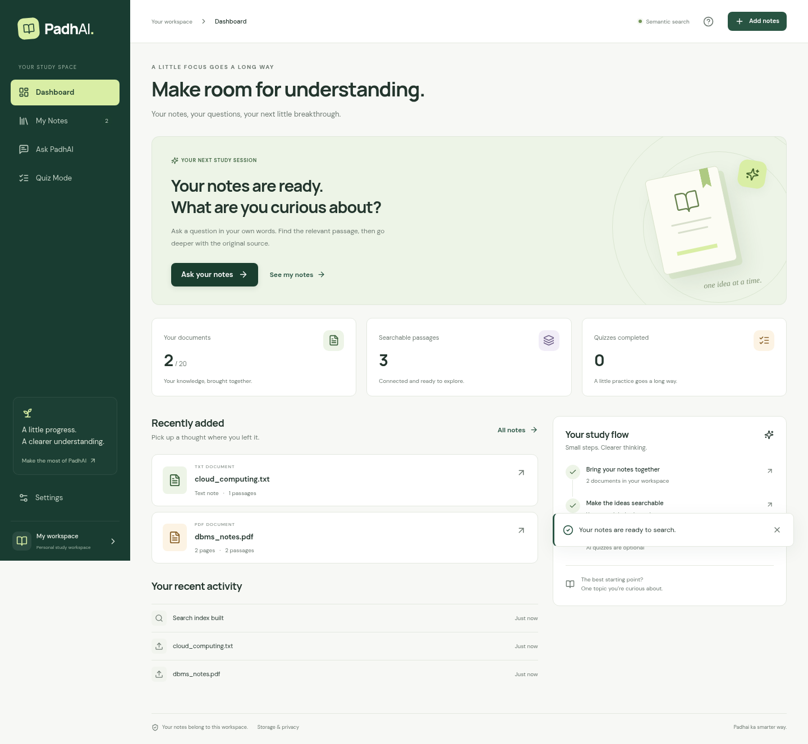
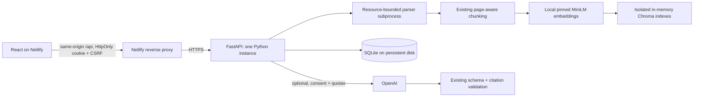

# PadhAI

**Padhai ka smarter way.** One study workspace for your notes, questions, sources, and practice.

The **0.2.0 platform** uses **React 19 + Vite + Tailwind CSS** and **Python FastAPI**. Netlify serves the frontend and proxies its `/api/*` requests to a Python backend. Uploads, semantic search, source previews, and quizzes stay inside the same interface. There are no Streamlit redirects in the new frontend.



**Release status:** the replacement is implemented and verified locally. The existing public Netlify and Streamlit deployments remain intact while a replacement backend and Netlify preview are prepared. This branch does not claim a completed production cutover. See the [audit](docs/platform/audit.md), [deployment guide](docs/platform/deployment.md), and [verification report](docs/platform/verification.md).

## What works

- **Dashboard:** actual document, indexed-passage, and completed-quiz counts; recent notes and activity.
- **My Notes:** PDF/TXT/Markdown upload, duplicate detection, samples, filename search, format filters, layouts, source preview, and deletion.
- **Ask PadhAI:** real local embeddings and Chroma retrieval; original passages with document/page references; optional evidence-checked AI answers.
- **Quiz Mode:** server-generated 5/10/20-question quizzes, difficulty selection, private answers until submission, grading, source-backed explanations, and retakes.
- **Settings:** workspace preferences, light/dark/system appearance, explicit AI consent, expiry/storage information, note clearing, and workspace reset.
- Responsive navigation, keyboard access, loading/error/empty states, and locally hosted fonts. No invented AI answers, user metrics, login forms, or billing features.

Semantic search needs **no paid API key**. It returns relevant passages, not generated prose. Answers and quizzes require optional server-side OpenAI configuration and workspace consent; unavailable generation has an explicit UI state.

## Run the integrated app

Use Python 3.11/3.12 and Node 22.13+ (Node 24 recommended). Linux is the deployment target; macOS supports the parser's POSIX resource limits. Windows users should use WSL2 or Docker.

```bash
python3 -m venv .venv
source .venv/bin/activate
python -m pip install --upgrade pip
# Linux CPU-only installation; on macOS, skip this line and let pip resolve PyTorch.
python -m pip install 'torch>=2.6,<3' --index-url https://download.pytorch.org/whl/cpu
python -m pip install -r requirements-dev.txt
npm --prefix frontend ci
python -m uvicorn api.main:app --host 127.0.0.1 --port 8000 --no-access-log
```

In another terminal:

```bash
npm --prefix frontend run dev
```

Open **http://localhost:5173**. Vite forwards `/api` to FastAPI on port 8000. Default allowed origins are exactly `http://localhost:5173` and `http://127.0.0.1:5173`. The landing page does not create a workspace until you open the app.

The first index build downloads the pinned `sentence-transformers/all-MiniLM-L6-v2` model; subsequent searches use the cached local model. The Docker image downloads it during its build and uses offline model loading at runtime.

No credentials are needed for the keyless flow. To use server settings from a file, copy [deployment/platform/.env.example](deployment/platform/.env.example) to a private file such as `api.env` **outside the repository**, and start Uvicorn with `--env-file /absolute/path/to/api.env`. API-specific settings are process environment variables; the existing root `.env` continues to supply the shared core's optional provider settings. Never commit real keys or put them in `VITE_*` variables.

## Try a complete study session

1. Open Dashboard → **Try sample notes**, or upload `sample_data/dbms_notes.pdf` and `sample_data/cloud_computing.txt` in My Notes.
2. Build the search index. Open Ask PadhAI and ask **“How does database normalization reduce redundancy?”**
3. Open **View source** on the PDF result. Read page 1 and navigate to page 2.
4. Ask **“What is IaaS in cloud computing?”** and inspect the text-note evidence.
5. When optional AI is enabled, give consent in Settings and generate an answer or quiz. Submitted quiz answers and explanations come from the backend; retakes make no new provider request.
6. Delete a note or clear the workspace and verify the old results disappear.

See the [portfolio demo guide](docs/platform/demo-guide.md) for a short presentation and honest talking points.

## Architecture



The reusable `src/` pipeline is preserved. The new `api/` layer adds ownership, expiry, durable state, background jobs, quotas, and HTTP contracts. Each index is replaced atomically; changing notes invalidates the index and stale in-flight results. Quiz solutions stay on the server until submission. Polling keeps model builds and generation outside long frontend requests.

| Location | Purpose |
| --- | --- |
| `frontend/` | React pages, shared design system, API client, component/browser tests |
| `api/` | FastAPI routes, request controls, workspace service, parser worker, SQLite |
| `src/` | Existing extraction, chunking, embeddings, retrieval, answer/quiz validation |
| `tests/api/` | API isolation, lifecycle, limits, scoring and concurrency tests |
| `deployment/platform/`, `render.yaml`, `netlify.toml` | Container and host configuration |
| `app.py`, `web/`, `deployment/streamlit/` | Preserved legacy implementation and rollback path |
| `evaluation/` | Existing fixed retrieval evaluation and recorded results |

## Storage, privacy, and limits

This is an **anonymous, temporary personal workspace**, not an account system. An opaque 256-bit HttpOnly cookie grants access; only its hash is stored server-side. There is no recovery after losing the cookie and no cross-device synchronization. Shared browsers share a workspace until reset or expiry.

Original uploads are discarded after parsing. Extracted text, filenames, metadata, jobs, preferences, quizzes, and attempts live in SQLite. Chroma indexes live in memory and need rebuilding after a restart. Notes survive a restart when the disk is persistent. Default expiry is **24 hours from workspace creation**, not sliding activity-based retention.

Deleting a note removes its stored text and filename activity, clears the index and derived quizzes/answers, and prevents in-flight results from being committed. Adding notes preserves existing quizzes because their sources remain unchanged. Clearing notes removes all study material; resetting deletes the whole workspace. Cleanup runs every 30 seconds while the server is running and also on access/startup. SQLite secure-delete and WAL truncation reduce residual database content; they are **not a forensic erasure guarantee** for memory, disk snapshots, host backups, or provider processing already started. The operator controls backup retention and can access server storage.

Defaults: 10 MiB/file, 20 notes/workspace, 50 MiB original-upload allowance/workspace, 2 million extracted characters/workspace, 20 million across the service, 100 workspaces, 5,000 chunks/workspace, and eight queued/running jobs. PDF parsing has CPU, memory, output, and time limits. It is a subprocess with a minimal environment, **not a full OS security sandbox**. Request rates, body sizes, concurrency, exact origins, CSRF, and ownership are checked server-side. See [security and operations](docs/platform/security.md).

## Hosting and optional AI

Use **Netlify for the frontend** and a **Render Docker web service with at least 2 GB RAM and a persistent disk** for FastAPI. `render.yaml` describes a single Standard instance and 1 GB disk; review Render's current price before provisioning. A comparable single-instance container host with persistent storage also works.

Set Netlify's public `PADHAI_API_ORIGIN` to the actual backend HTTPS origin. The build writes a reverse proxy rule before the SPA fallback and fails if that setting is missing or unsafe. Set backend `API_ALLOWED_ORIGINS` to the exact preview/production frontend origins, never `*`. Production uses a Secure `__Host-` cookie. The browser talks only to its Netlify origin; backend and frontend remain separate infrastructure behind one user-facing site.

Optional AI needs **both** `ENABLE_PAID_AI=true` and backend-only `OPENAI_API_KEY`, followed by workspace consent. Default limits are five generation requests/workspace and 50/service/day, counted durably before calling the provider, including failures. Requests contain selected excerpts, filenames, and the question/settings. The shared core asks the provider for `store=False`; provider policies still apply. No secrets appear in frontend source, configuration, build output, or API responses.

Follow the [step-by-step deployment and safe cutover guide](docs/platform/deployment.md). Do not promote the replacement until the hosted preview passes the complete workflow. Keep the current Streamlit deployment available for rollback.

## Verification

```bash
python -m pytest -q                  # preserved core/legacy + new API tests
npm --prefix frontend test          # React and API-client tests
npm --prefix frontend run test:hosting
npm --prefix frontend run build     # TypeScript + Vite production build
npm --prefix web test               # preserved 0.1.0 landing checks
```

With the API and Vite running, install a browser and run the real integration suite:

```bash
cd frontend
npx playwright install chromium
npm run test:e2e
```

`CHROMIUM_PATH=/usr/bin/chromium` selects an existing system browser. Browser tests use actual uploads, parsing, MiniLM embeddings, and Chroma. Provider generation is exercised with controlled fixtures and the existing transport/validation tests; **live paid OpenAI calls are not claimed as verified**. See the [verification record](docs/platform/verification.md).

The existing small retrieval evaluation remains available at [docs/retrieval-results.md](docs/retrieval-results.md). Its recorded results describe that fixed dataset, not general model accuracy.

## Legacy and release artifacts

The previous Streamlit entry point still runs with `python -m streamlit run app.py`. The old deployment and demo instructions are retained under `docs/deployment.md` and `docs/demo-guide.md` for rollback. The `v0.1.0` tag and release remain unchanged.

Build a source-only archive from the reviewed allowlist with `python scripts/build_release.py --output-dir dist`. Generated assets, dependencies, databases, private notes, and credentials are excluded. New platform sources are versioned as 0.2.0; no production release is implied until the deployment gate is completed.

[MIT License](LICENSE)
