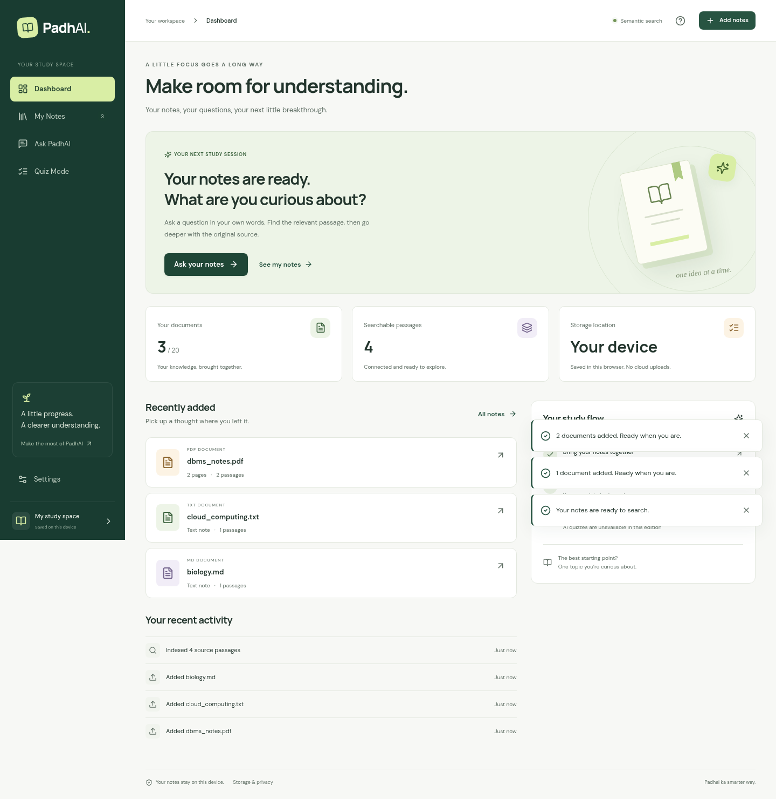

# PadhAI — Padhai ka smarter way.

A polished study workspace for your own notes: **React + Vite + Tailwind**, real semantic search, PDF page references, and source previews. This branch runs entirely in the browser and deploys as static files on Netlify. No Python host, account, API key, or paid inference is needed.

**[Open the verified Netlify preview](https://browser-preview--padhai-ishan.netlify.app)** · [Implementation PR](https://github.com/ishanwork43-bit/padhAI/pull/2) · [Verification evidence](docs/browser/verification.md)



## Two architectures, both preserved

| | Browser edition — this branch | Full-stack platform — preserved |
| --- | --- | --- |
| Branch | [`feat/browser-only-padhai`](https://github.com/ishanwork43-bit/padhAI/tree/feat/browser-only-padhai) | [`feat/integrated-platform`](https://github.com/ishanwork43-bit/padhAI/tree/feat/integrated-platform) |
| Interface | Existing React / Vite / Tailwind design; six pages | Same design with server features |
| Processing | PDF.js + text decoder in Web Workers | Python extraction in a bounded subprocess |
| Semantic search | Transformers.js, quantized MiniLM, local cosine ranking | Sentence Transformers, MiniLM, Chroma retrieval |
| Citations | Original text, exact offsets, PDF page numbers | Validated retrieval and generated-answer citations |
| Storage | IndexedDB in this browser, including vectors | Owner-isolated SQLite + in-memory Chroma indexes |
| Generated answers / quizzes | Clearly unavailable; no imitation responses | Existing server-side RAG, citation validation, and quiz scoring |
| Hosting | Static Netlify Free plan, within its included usage | Netlify + a separately hosted FastAPI service |
| Keys | None | Optional AI key stays only on the backend |

**The complete Python implementation is retained.** `api/`, `src/`, legacy Streamlit code, backend tests, and Docker/Render files have not been replaced. The original full-stack frontend HTTP client is preserved in `frontend/src/lib/http-api.ts`; the browser adapter selects the local engine. See [the preserved full-stack README](README.fullstack.md), [architecture audit](docs/platform/audit.md), and [server deployment guide](docs/platform/deployment.md).

## Run the browser edition

Use Node **22.13+ or 24**:

```bash
git switch feat/browser-only-padhai
npm --prefix frontend ci
npm --prefix frontend run dev
```

Open the URL printed by Vite. The first build downloads public, pinned model artifacts and checks their SHA256 hashes. Runtime assets are generated into ignored directories; user documents never enter a build. The `.npmrc` skips the unused native CUDA download; inference uses WebAssembly.

1. Open your workspace and add a readable PDF, TXT, or Markdown file, or choose a public sample.
2. Build the search index. The browser downloads approximately **45 MB** of quantized model/runtime files on first use. The model is cached separately from notes.
3. Search in your own words. Results are original passages with source references; they are not generated answers.
4. Open a source, change PDF pages, filter your library, or delete notes.
5. Refresh: notes, preferences, and the completed index remain in this browser.

The MiniLM model is English-focused. Other languages can be imported, but retrieval quality is not guaranteed. OCR, image understanding, encrypted PDFs, and cloud synchronization are not included. Quizzes and answer generation explain why they are unavailable. No button calls a paid provider.

## Local storage and privacy

Extracted page text, filenames, preferences, activity, and normalized vectors are stored in **IndexedDB** under this site's origin. Original uploaded file bytes are discarded after processing. Heavy PDF parsing and model inference run in workers. Search uses the real pinned `Xenova/all-MiniLM-L6-v2` Q8 model, 384-dimensional vectors, cosine similarity, and token-safe weighted windows rather than truncating long passages.

Notes and questions are not sent to a server. Model/runtime files and selected public samples are requested from the same Netlify origin. The host receives ordinary static-file requests, such as IP addresses; that is separate from document content. The build may download public model weights from Hugging Face, but the deployed browser does not contact Hugging Face or an AI API.

Anyone with access to this browser profile can access its notes. Storage is not password-protected or end-to-end encrypted. Browser eviction, clearing site data, private browsing, or using another device/origin can lose access. Keep your originals; this is not a backup system. The app has no fixed 24-hour expiry in browser mode. A loaded app/model can search without a network connection, but reopening the whole website offline is not guaranteed.

Deleting a note removes its stored text and clears the index. Clearing notes removes all notes, vectors, and activity; resetting also removes preferences. Atomic IndexedDB writes and revision checks prevent an old index or import from restoring deleted material. Other tabs are notified to discard displayed results. Browser and OS forensic erasure is not guaranteed. Public model cache files contain no study material and can be removed through browser site-data controls.

Limits: **10 MiB/file, 20 documents, 50 MiB original-file allowance, 500,000 extracted characters, 1,200 passages, and 200 pages/PDF**. Oversized, unreadable, empty, binary, and unsupported inputs fail with actionable messages. A PDF parser timeout stops its worker. Storage quota errors preserve the prior transaction. Model-load failures leave notes available for retry.

## Deploy to Netlify at ₹0

The root `netlify.toml` builds `frontend/` in **browser** mode. No backend environment variable or API key is required. All files, including the pinned model and WebAssembly runtime, are static. Only a same-origin SPA rewrite is generated; there is no Streamlit redirect or API proxy in browser mode.

```bash
npm --prefix frontend run build:netlify
netlify deploy --site padhai-ishan --dir frontend/dist --alias browser-preview --no-build
```

This creates a **preview**, not a production replacement. Verify the returned URL with the [browser verification checklist](docs/browser/deployment.md). Keep the existing live deployment until review and verification are complete. No new hosting account or payment method is needed. Stay on Netlify's Free plan and within its included usage; model downloads consume bandwidth/credits. Do not enable paid add-ons or automatic upgrades to avoid a usage pause.

After verification and approval for production, publish the same tested build:

```bash
netlify deploy --site padhai-ishan --dir frontend/dist --prod --no-build
```

Preview and production have **different IndexedDB origins**. Notes imported into a preview are not automatically transferred to production; reimport original files on the production address. Retain the previous Netlify deploy for rollback.

## Return to FastAPI later

The simplest route is to check out **`feat/integrated-platform`** and follow its [deployment guide](https://github.com/ishanwork43-bit/padhAI/blob/feat/integrated-platform/docs/platform/deployment.md). That branch is unchanged by this browser implementation.

This branch also retains the HTTP adapter. To use its frontend against the existing FastAPI API during development:

```bash
# Terminal 1, after installing requirements-api.txt in a Python environment
python -m uvicorn api.main:app --port 8000
# Terminal 2
VITE_PADHAI_MODE=server npm --prefix frontend run dev
```

For a future hosted server build, set `VITE_PADHAI_MODE=server` **for both compilation and hosting generation**, set `PADHAI_API_ORIGIN` to the real backend HTTPS origin, and change the browser setting in `netlify.toml`. Configure the backend's exact frontend origins and persistent storage. Provider secrets belong only on the backend. Test a separate preview before promotion. Local browser notes do not migrate to the server automatically; reimport the originals. See [full-stack deployment](docs/platform/deployment.md) for limits, cookies, optional AI, retention, and rollback.

## Verify

```bash
npm --prefix frontend test
npm --prefix frontend run test:hosting
npm --prefix frontend run build:netlify
# With the production preview running on port 4174:
E2E_URL=http://localhost:4174 npm --prefix frontend run test:e2e
python -m pytest -q
```

Browser integration tests use actual PDF/TXT/Markdown extraction, the real quantized ONNX model, real IndexedDB, and real source previews. They check paraphrased retrieval, PDF page accuracy, refresh persistence, offline search after load, profile isolation, cross-tab deletion, mobile layouts, duplicates, and malformed input. The existing server/quiz/client tests remain; use `E2E_MODE=server` for the preserved full-stack browser suite. Current execution evidence is recorded in [browser verification](docs/browser/verification.md).

[Third-party model/runtime notices](frontend/public/licenses/THIRD_PARTY.md) · [Project license](LICENSE)
