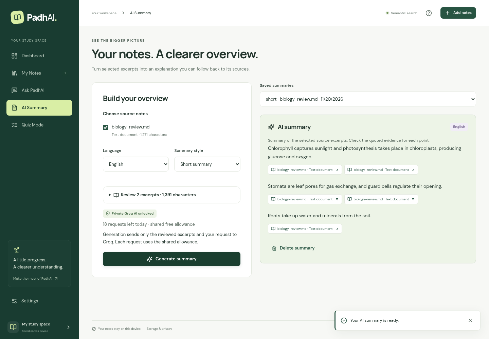
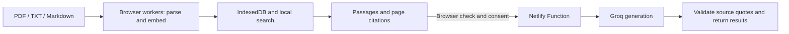

# PadhAI

**Padhai ka smarter way.**

PadhAI helps students find explanations in their own study notes. Import a PDF, TXT, or Markdown file, search by meaning, and open the passage behind each result. Optional Groq generation turns selected excerpts into answers, summaries, and practice questions.

[Open the preview](https://groq-preview--padhai-ishan.netlify.app) — notes, search, and AI tools are public. No invitation or account is required.



Screenshot from the earlier preview; AI access is now public.

## Features

- Automatic PDF/TXT/Markdown indexing and semantic search in browser workers, with page-aware source previews.
- Notes and search vectors stored locally in IndexedDB, with document deletion and persistence after refresh.
- Source-linked AI answers, short summaries, and key takeaways after explicit excerpt-sharing consent.
- Five- and ten-question quizzes with scoring, explanations, and saved attempts. Twenty questions is disabled as **Coming soon**.
- Anonymous visitor protection, server-side credentials, request limits, and shared quotas enforced by Netlify Functions.

## How it works



PDF.js extracts text; Transformers.js runs a quantized MiniLM model to find related passages. This keeps document processing local and avoids a hosted embedding server. Groq receives only reviewed excerpts through a Function, which keeps the API key out of the browser. Quizzes reference server-numbered excerpts; answers and summaries use exact-quote checks. These links preserve the original evidence but cannot prove every inference is correct.

**Stack:** React, TypeScript, Vite, Tailwind CSS, PDF.js, Transformers.js, IndexedDB, Netlify Functions, Netlify Blobs, and Groq (`openai/gpt-oss-120b`). Blobs stores shared security counters, not study documents.

## Run locally

Use Node.js 24:

```bash
git clone https://github.com/ishanwork43-bit/padhAI.git
cd padhAI
git checkout feat/groq-ai-platform
npm ci
npm --prefix frontend ci
npm --prefix frontend run dev
```

Open `http://localhost:5173`. Local search needs no API key. Startup prepares the pinned public model assets; the first browser indexing session downloads about 45 MB. Optional AI needs the [Netlify Function runtime configuration](docs/deployment.md); never place credentials in `VITE_` variables.

Upload notes and wait for “Your notes are ready!” Preparation runs locally in the background and reuses unchanged passages. Interrupted work resumes after refresh; failures offer a retry. Settings includes a manual rebuild for troubleshooting.

## Limitations

- Notes belong to this browser profile and site address. Clearing browser data can remove them; keep the original files. There is no cloud sync or backup.
- The embedding model is English-focused. Scanned PDFs needing OCR and encrypted PDFs are unsupported.
- Local indexing requires a recent browser with IndexedDB, Web Workers, WebAssembly, and Web Locks support, over HTTPS or localhost.
- AI has per-network and shared daily quotas. A browser proof-of-work check slows basic bots; shared networks may share limits. Distributed abuse can still exhaust the free allowance.
- Real checks passed for English short answers, short summaries, key takeaways, and 5/10-question quizzes. Broader Hinglish/detailed generation and live UI retakes remain unverified. See the [test results and known issues](docs/verification.md).

## Next steps

Improve Hinglish retrieval evaluation, add local export/import, and resolve twenty-question generation before enabling it. Evaluate stronger abuse protection as public usage grows.

## Engineering notes

- [Architecture, privacy, and repository audit](docs/audit/architecture.md)
- [Deployment and public access](docs/deployment.md)
- [Tests and verification](docs/verification.md)
- Preserved editions: [React + FastAPI](https://github.com/ishanwork43-bit/padhAI/tree/feat/integrated-platform) · [browser-only](https://github.com/ishanwork43-bit/padhAI/tree/feat/browser-only-padhai)

[License](LICENSE) · [Third-party attribution](frontend/public/licenses/THIRD_PARTY.md)
