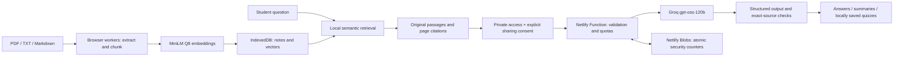

# PadhAI — Padhai ka smarter way.

A study workspace that combines private browser-based semantic search with optional, source-grounded Groq explanations, summaries, and practice quizzes. Students keep their notes locally and choose exactly when excerpts leave their device.

[Groq development preview](https://groq-preview--padhai-ishan.netlify.app) · [Preserved FastAPI platform](https://github.com/ishanwork43-bit/padhAI/tree/feat/integrated-platform) · [Verified browser-only baseline](https://github.com/ishanwork43-bit/padhAI/tree/feat/browser-only-padhai)

The Groq preview is under verification. Production has not been changed. Local search is public; AI generation requires a private invitation from the project owner. Do not enter a Groq API key into the website.


## What it does

- Imports selectable PDF text, TXT, and Markdown in Web Workers.
- Builds real 384-dimensional embeddings using a SHA-pinned quantized MiniLM model through Transformers.js.
- Searches by meaning and opens original passages with PDF page numbers and exact text offsets.
- Generates English or Hinglish answers, short/detailed summaries and key takeaways from reviewed excerpts after explicit consent.
- Creates MCQ quizzes with difficulty controls, local scoring, explanations, citations, and free retakes. Five- and ten-question generation passed real checks; the twenty-question option remains experimental and can fail validation. See [verification](docs/verification.md).
- Saves notes, search indexes, summaries, and quizzes in IndexedDB. Deletion clears derived results and revision guards reject stale in-flight work.

AI source-ID and quote checks reject fabricated evidence; quiz validation also checks options, duplicates, and correct-answer evidence. These checks do not prove every generated inference. Review the sources before relying on a result.

## Architecture



Retrieval-augmented generation (RAG) supplies only selected source passages to the model. Embeddings and similarity ranking happen locally; Groq performs optional generation server-side. PDF bytes and vectors never go to Groq. The Function sends source text and the task, then maps checked citations back to the original filenames/pages.

**Stack:** React, TypeScript, Vite, Tailwind, PDF.js, Transformers.js, IndexedDB, Netlify Functions, Netlify Blobs, and Groq's official HTTPS API. The complete Python/FastAPI/Chroma implementation remains on its separate branch with its original tests.

## Run locally

Use Node 24:

```bash
npm ci
npm --prefix frontend ci
npm --prefix frontend run dev
```

Local search needs no secret or server. The first build prepares integrity-checked public model/runtime assets; the first browser indexing session downloads approximately 45 MB. The model is English-focused. OCR, encrypted PDFs, cloud synchronization, and automatic backups are not included.

AI requests require the Netlify Function runtime. Set `GROQ_API_KEY` only in that runtime, plus a high-entropy private invitation hash (`PADHAI_AI_ACCESS_HASH`, SHA256), a separate random session-signing secret, and `PADHAI_AI_ENABLED=true`. Never use a `VITE_` variable for credentials. `.env.example` contains names only. See [deployment](docs/deployment.md).

## Privacy and free-tier limits

Local study data belongs to this browser profile and origin. Anyone using that profile can access it. Clearing site data, private browsing, browser eviction, or changing domains can lose access; keep original files. This is a practice tool, not a secure exam system: locally stored answer keys are inspectable.

Generation is private by default, with expiring HttpOnly/Secure/SameSite cookies, CSRF checks, explicit consent, fixed provider/model, bounded inputs, timeouts, and safe errors. Strongly consistent conditional writes enforce shared quotas across Function instances and deploys. Netlify stores security metadata only; application code does not persist or log study content on the server. Previously sent excerpts remain subject to Groq/platform policies and cannot be recalled by deleting local notes.

Default AI limits: up to 20 shared requests per UTC day, a conservative 180,000-token reservation budget, and a one-minute cooldown. Large requests and Groq's own limits can reduce availability. No automatic provider retries or unlimited usage are promised. Netlify Free quotas apply to static downloads, functions, and storage; public traffic can exhaust hosting quota even though private access protects Groq allowance. No paid upgrades are enabled.

## Tests and evidence

```bash
npm test
npm --prefix frontend test
npm --prefix frontend run test:hosting
npm --prefix frontend run build:netlify
npm run test:security
npm --prefix frontend run preview -- --port 4176 --strictPort
# Another terminal, after installing Playwright Chromium:
E2E_URL=http://localhost:4176 npm --prefix frontend run test:e2e
```

[Verification](docs/verification.md) separates deterministic fixture tests from actual Groq requests. CI never uses a real provider key. [Audit](docs/audit/architecture.md) and [removed-file ledger](docs/audit/removed-files.json) explain cleanup without rewriting history or deleting preserved branches.

## Roadmap

Complete live Groq verification and production review; improve retrieval evaluation for Hinglish; add optional local export/import; evaluate stronger per-user access before opening generation publicly. Hosted Python retrieval remains a separate future deployment option.

[License](LICENSE) · [Third-party notices](frontend/public/licenses/THIRD_PARTY.md)
